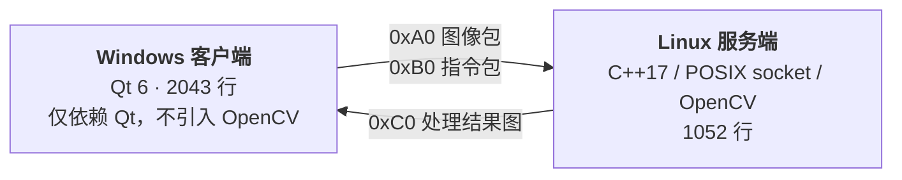
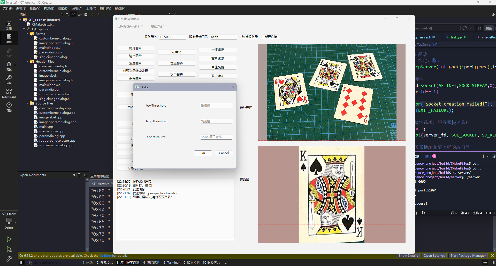
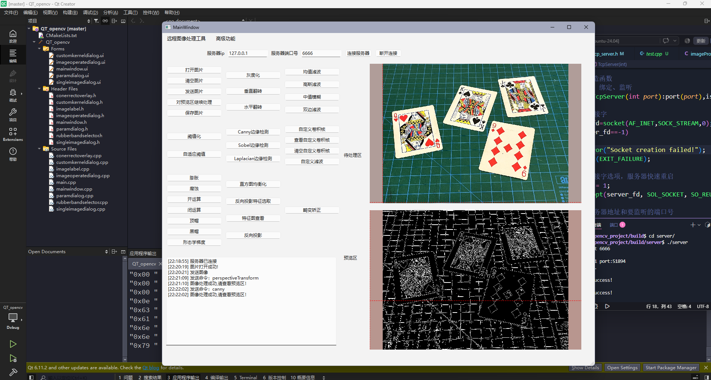
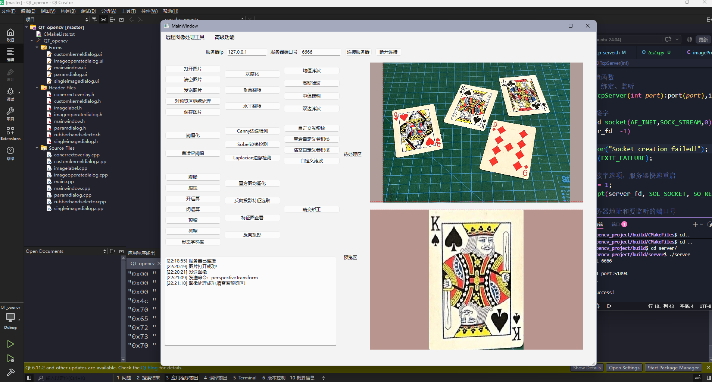
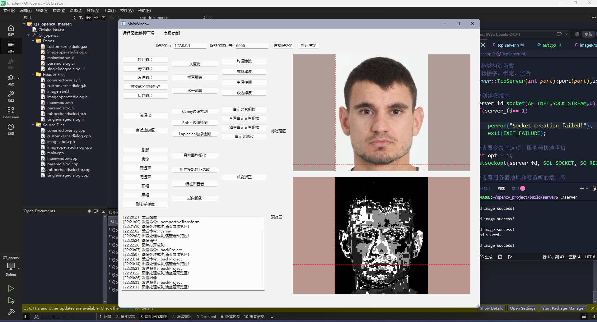

# 远程图像处理系统

基于 **Qt 客户端 + Linux 服务端** 的远程图像处理系统。客户端负责交互与组包，服务端用 OpenCV 完成实际计算后回传结果，两端之间使用自定义的 TCP 应用层协议通信。

> 本项目为个人学习项目，目标是打通「图像编码 → 网络传输 → 服务端处理 → 结果回传」的完整链路，并实践协议设计与并发服务器。

---

## 系统架构



| 端 | 模块 | 说明 |
|---|---|---|
| 客户端 | UI 交互层 | 23 条处理指令，参数通过声明式表单动态生成 |
| 客户端 | 自绘交互控件 | 像素 RGB 探针、ROI 框选、透视变换角点拖拽 |
| 客户端 | 协议封装层 | `QDataStream` 大端序组包 / 解包 |
| 服务端 | 并发接入层 | accept 主线程 + 每连接一线程 |
| 服务端 | 会话上下文 | `clientContext` 为线程栈上对象，零共享状态、无需加锁 |
| 服务端 | 算法库 | `imageProcessor` 独立编译为静态库 `imgProcessor` |

**分层约定**：客户端只链接 `Qt::Widgets` 与 `Qt::Network`，不包含任何 OpenCV 调用。图像在客户端就是一个 `QByteArray`，所有 OpenCV 计算都在服务端完成。

---

## 通信协议

采用 **TLV 式帧格式**：定长头声明变长载荷的长度，解决 TCP 字节流的粘包 / 拆包问题。

```
+----------+----------------+---------------------------+
| type 1B  | length 4B (BE) | payload（变长）            |
+----------+----------------+---------------------------+
```

- 两端统一**大端序**：服务端 `htonl/ntohl`，客户端 `QDataStream::setByteOrder(BigEndian)`
- 头定长 5 字节，保证接收端永远能定位载荷起点

| type | 方向 | payload | 用途 |
|---|---|---|---|
| `0xA0` | 上行 | JPEG 二进制 | 待处理图像 |
| `0xB0` | 上行 | UTF-8 指令串 | 处理命令 + 参数，以 `\|` 分隔 |
| `0xC0` | 上行 / 下行 | JPEG 二进制 | 上行：反向投影模板图；下行：处理结果图 |

**指令示例**：`canny|50|150|3`、`blur|5`、`perspectiveTransform|x1|y1|...|x4|y4`

**粘包处理**
- 服务端：先 `MSG_WAITALL` 读满 1 字节类型 + 4 字节长度，再循环 `recv` 直到读满载荷
- 客户端：`readyRead` 信号驱动的状态机，头不足 5 字节时直接返回等下一次，收满一帧再解码显示

---

## 效果展示

| 参数输入窗口 | Canny 边缘检测 |
|:---:|:---:|
|  |  |

| 四点畸变矫正 | 反向投影检测目标区域 |
|:---:|:---:|
|  |  |

> 左上为待处理区，右下为服务端回传的预览区。底部实时显示鼠标所指像素的坐标与 RGB 值，右侧文本框记录每一步指令与状态。

---

## 已实现的处理指令（23 条）

| 类别 | 指令 |
|---|---|
| 颜色与几何 | `grayscale`、`flipx`、`flipy`、`perspectiveTransform` |
| 空域滤波 | `blur`、`medianblur`、`gaussian`、`bilateralFilter`、`custom` |
| 边缘检测 | `canny`、`sobel`、`laplacian` |
| 阈值化 | `threshold`、`adaptive`、`equalizeHist` |
| 形态学 | `dilate`、`erode`、`open`、`close`、`gradient`、`tophat`、`blackhat` |
| 直方图 | `backProject` |

---

## 目录结构

```
.
├── client/                 # Qt 6 客户端（Windows）
│   ├── mainwindow.cpp      # 主逻辑：socket 收发、组包解包、指令分发
│   ├── imagelabel.cpp      # 自绘 QLabel：等比缩放、RGB 探针、坐标映射
│   ├── paramdialog.cpp     # 声明式动态参数表单
│   ├── customkerneldialog.cpp   # 表格化自定义卷积核
│   ├── conerrectoverlay.cpp     # 透视变换四角点拖拽
│   ├── rubberbandselector.cpp   # ROI 框选
│   └── ...
├── server/                 # 服务端（Linux）
│   ├── server/
│   │   ├── tcp_server.cpp  # socket 接入、并发、三种包的收发
│   │   └── serverMain.cpp
│   └── image_processing/
│       └── imageProcessor.cpp   # 23 条 OpenCV 指令实现与分发
├── docs/
│   ├── screenshots/        # 效果截图
│   └── development-timeline.txt
└── README.md
```

---

## 编译与运行

### 服务端（Linux）

```bash
cd server
mkdir -p build && cd build
cmake ..
make
./server/server        # 默认监听 6666 端口
```

依赖：OpenCV 4.x、CMake ≥ 3.10、支持 C++17 的编译器

### 客户端（Windows）

使用 Qt Creator 打开 `client/CMakeLists.txt`，选择 Qt 6.x MinGW 64-bit 套件编译运行。

连接后在界面填入服务端 IP 与端口（默认 6666），先选择图片并发送，再选择处理指令。

---

## 已知问题与改进方向

本项目定位是学习性质的链路验证，离生产级服务还有明确差距，记录如下：

| 问题 | 说明 | 改进方向 |
|---|---|---|
| 接收循环未处理连接关闭 | `recv` 返回 0 时会进入死循环 | 判断改为 `bytes <= 0` |
| 异常未兜底 | `process()` 内部会 `throw`，未捕获会终止该客户端线程 | 外层 try-catch，返回错误码包 |
| 长度校验不对称 | 指令包有 10MB 上限保护，图像包未做校验 | 图像包同样加上限，先校验再分配 |
| 并发模型受限 | 一连接一线程，连接数增长后切换开销大 | 改用 `epoll` + 线程池，连接数与线程数解耦 |
| 协议严谨性 | `0xC0` 类型码上下行复用；无版本号、校验和、心跳 | 拆分类型码，补充帧校验与心跳机制 |
| 图像有损累积 | 上传与回传各压缩一次，链式处理会累积损失 | 质量可配置，精度敏感场景改用无损格式 |
| 算法分发方式 | 目前为 if-else 链 | 改为命令注册表，支持运行时注册 |

---

## 开发时间线

原始开发记录见 [docs/development-timeline.txt](docs/development-timeline.txt)：

```
2025-06-23  初始化
2025-06-25  根据包头分发到图像处理 / 命令处理
2025-06-26  创建图像处理模块
2025-06-27  完成图像接收与参数解析
2025-07-05  添加滤波功能
```
